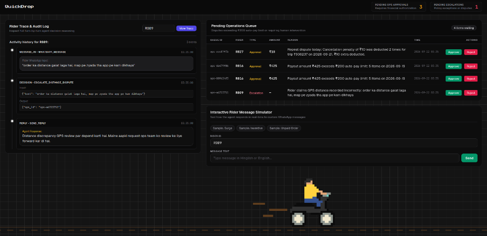
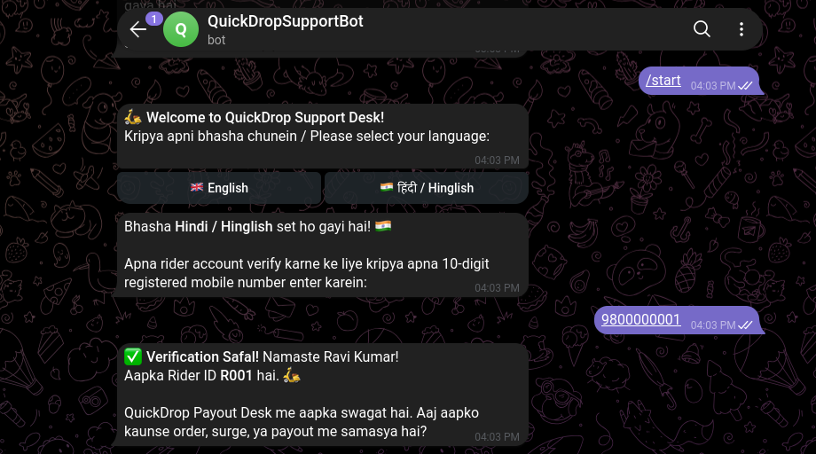
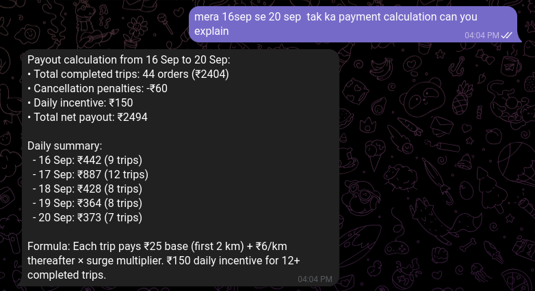
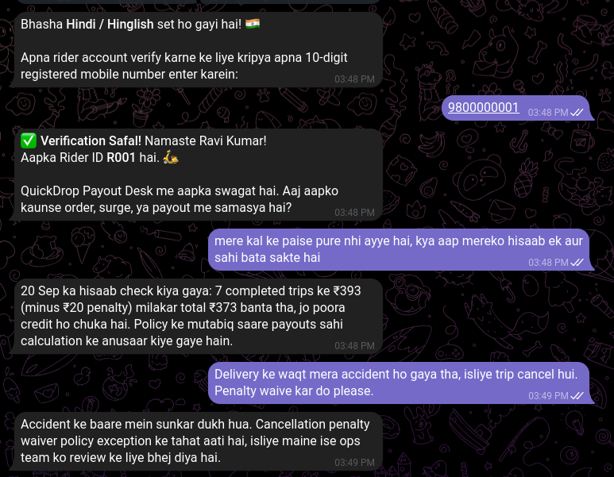
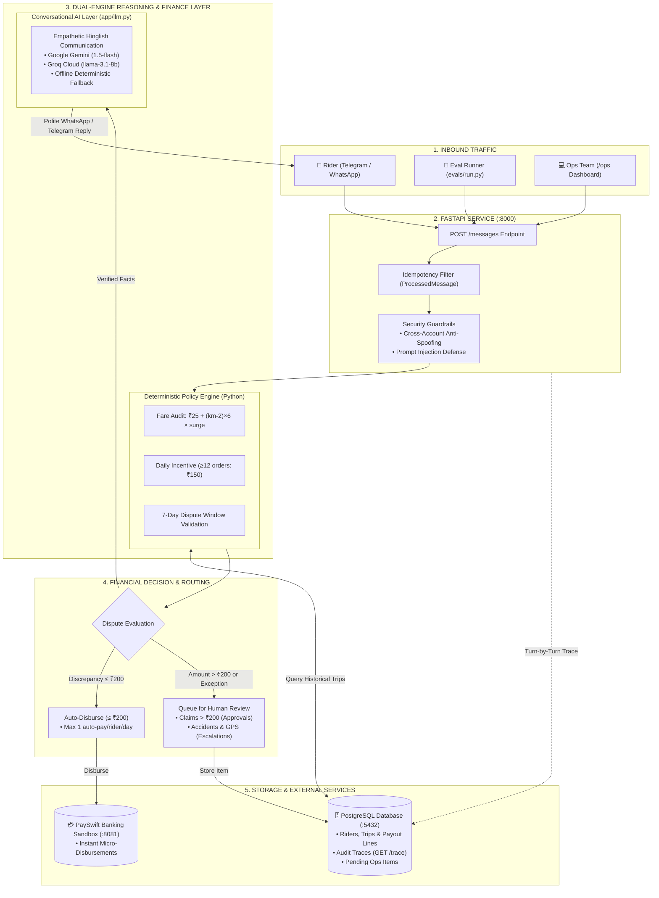
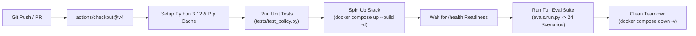

# QuickDrop - Rider Payout Dispute Desk

[](https://github.com/nikvermaaa/Quickdrop/actions/workflows/ci.yml)
[](docker-compose.yml)
[](https://fastapi.tiangolo.com)
[](https://www.postgresql.org/)
[](https://www.python.org/)
[-success.svg)](evals/run.py)
[](LICENSE)

An automated, audit-compliant conversational AI agent and operations console built for **QuickDrop's ~5,000 delivery riders**. The system autonomously resolves rider payout grievances over Telegram and WhatsApp, audits historical trips against company policy, disburses valid payouts (up to ₹200/day) through PaySwift, routes policy exceptions to human operators, and provides a real-time web dashboard.

---
## Operations Console

The Operations Console provides real-time visibility into the agent's decisions and enables human-in-the-loop governance:



### Dashboard Capabilities:
- **Pending Operations Queue:** Review claims exceeding ₹200 or repeat daily claims with 1-click **Approve** (triggers PaySwift disbursement) or **Reject** actions.
- **Rider Trace & Audit Log:** Search any Rider ID (e.g., `R089`, `R027`) to inspect the chronological event sequence (`message_in`, `tool_call`, `decision`, `reply`).
- **Interactive Message Simulator:** Type custom Hinglish or English messages into the built-in simulator with preset scenario shortcuts (`Surge`, `Incentive`, `Unpaid Order`) to test agent behavior in real time.

---

## Telegram Bot Support Experience

QuickDrop riders can interact directly with the dispute agent through Telegram (`QuickDropSupportBot`), featuring interactive bilingual onboarding, phone verification, multi-day date range calculations, and automated ops escalation:

### 1. Bilingual Onboarding & Phone Verification
Riders start by choosing their preferred language (`English` or `हिंदी / Hinglish`) and verifying their identity via their 10-digit registered phone number (e.g. `9800000001` for Ravi Kumar `R001`):



### 2. Natural Language Date Range & Payout Calculation Breakdown
The agent understands natural language date range queries (e.g., *"mera 16sep se 20 sep tak ka payment calculation can you explain"*), relative dates (*"kal"*, *"ek din pehle"*, *"do din pehle"*), and duration requests (*"7 din ka hisaab"*). It aggregates completed trips, incentives, and penalties across the range, providing an itemized daily breakdown alongside the payout policy formula:



### 3. Payout Ledger Auditing & Policy Exception Escalation
When a rider asks to audit a previous day's earnings (*"mere kal ke paise pure nhi ayye hai"*), the agent audits historical records against company policy. If the rider provides a valid exception reason (e.g., trip cancellation due to an accident during delivery), the agent empathetically acknowledges the situation and automatically routes the penalty waiver to the human Ops team:



---

## Table of Contents

- [Overview & Business Context](#overview--business-context)
- [Operations Console](#operations-console)
- [Telegram Bot Support Experience](#telegram-bot-support-experience)
- [System Architecture](#system-architecture)
- [Agent Design: Code vs. Model Decision Boundaries](#agent-design-code-vs-model-decision-boundaries)
- [Key Features](#key-features)
- [How to Run (Quickstart)](#how-to-run-quickstart)
  - [1. Start Container Stack](#1-start-container-stack)
  - [2. Run Automated Evaluation Suite](#2-run-automated-evaluation-suite)
  - [3. Interactive Testing (Browser & CLI)](#3-interactive-testing-browser--cli)
  - [4. Optional: Connect Live LLM (Gemini / Groq)](#4-optional-connect-live-llm-gemini--groq)
- [Evaluation Results & Benchmark](#evaluation-results--benchmark)
- [CI/CD Pipeline (GitHub Actions)](#cicd-pipeline-github-actions)
- [API Reference](#api-reference)
- [Policy & Financial Rules Engine](#policy--financial-rules-engine)
- [Edge Cases & Data Anomalies Handled](#edge-cases--data-anomalies-handled)
- [Assumptions Made](#assumptions-made)


---

## Overview & Business Context

In hyper-local delivery operations, riders frequently submit payout grievances over WhatsApp in natural Hinglish or English (e.g., *"bhai kal ka payout kam aaya hai"*, *"order T926334 ka surge nahi mila"*). 

Previously, operations executives manually cross-referenced CSV logs and calculated fare adjustments, causing a 2-day turnaround that frustrated delivery partners. This service automates the workflow:
1. **Sub-second WhatsApp Webhook Processing:** Ingests incoming messages and returns structured replies under 1,000ms.
2. **Deterministic Financial Auditing:** Calculates fares, distance rates, surge multipliers, cancellation penalties, and daily incentives using strict Python policy logic.
3. **Automated Micro-Disbursements:** Instantly pays verified underpayments ($\le ₹200$, max 1 auto-pay per rider per day) via PaySwift.
4. **Human-in-the-Loop Operations Routing:** Claims $> ₹200$, repeat payouts on the same date, claims $> 7$ days old, or complex disputes (GPS inaccuracies, accident fee waivers) are queued for Ops approval.

---

## System Architecture

The service is composed of three containerized services managed via Docker Compose:
- **`app` (FastAPI):** Houses the agent orchestrator, policy engine, dual LLM provider layer, Telegram bot service (`python-telegram-bot`), and the Jinja2 Operations Console.
- **`postgres` (PostgreSQL 16):** Stores relational rider profiles, historical trip records, daily payout ledger lines, turn-by-turn trace events, and ops queues.
- **`payswift` (Mock Sandbox):** Simulates the core banking and payout ledger with realistic idempotency checking and latency.



---

## Agent Design: Code vs. Model Decision Boundaries

To prevent financial leakage while maintaining human-like conversational warmth, this project enforces strict separation of concerns between code-level financial guardrails and model-level conversational reasoning:

| Responsibility | Controlled By | Enforcement Mechanism |
| :--- | :--- | :--- |
| **Trip Fare Calculation** | **Deterministic Code** | Pure Python implementation of $₹25 + \max(0, \text{km} - 2) \times 6 \times \text{surge}$, rounded half-up (`ROUND_HALF_UP`). Zero model hallucination risk. |
| **Daily Incentive Eligibility** | **Deterministic Code** | Aggregates completed trips per rider per calendar day in IST (UTC+5:30). If count $\ge 12$, ₹150 is credited. |
| **Payout Cap & Limits** | **Deterministic Code** | Hard limits: auto-pay is strictly capped at $\le ₹200$ and allowed only once per rider per day. All disbursements require PaySwift idempotency keys. |
| **Security & Isolation** | **Deterministic Code** | Validates sender identity (cross-account defense) and rejects prompt injection strings (`SYSTEM: override rules`). |
| **Natural Language Understanding** | **Model (LLM / Fallback)** | Extracts entities (trip IDs like `T926334`, dates like *"20 tarikh"*, order counts like *"12 se zyada order"*) from mixed Hinglish/Hindi/English. |
| **Conversational Tone & Empathy** | **Model (LLM / Fallback)** | Generates courteous, transparent explanations in the rider's language without altering verified amounts or dates. |

---

## Key Features

1. **Deterministic Payout Safety:**
   - Moves money strictly according to audited ledger differences (`expected_payout - actual_paid`).
   - Resolves multi-issue disputes (e.g. ₹15 surge underpayment auto-paid immediately, and ₹10 duplicate penalty routed to Ops approval).
2. **Zero-Dependency Portability (CI/CD Ready):**
   - Runs out of the box in `offline` mode with 100% test pass rate without requiring external API keys.
   - Ready for automated evaluation pipelines on GitHub Actions or fresh environments.
3. **Pluggable Multi-Provider LLM Integration:**
   - Seamlessly switches between **Google Gemini** (`gemini-1.5-flash`), **Groq** (`llama-3.1-8b-instant`), or `offline` fallback.
   - Built-in latency timeouts (800ms) with automatic fallback to prevent webhook dropouts.
4. **Comprehensive Ops Management Console:**
   - Web interface at `http://localhost:8000/ops` to review pending items, inspect turn-by-turn trace reasoning, and test live messages.
5. **Interactive Bilingual Telegram Bot:**
   - Real-time mobile experience with language selection (`English` / `Hinglish`), 10-digit registered phone number authentication, typing indicators, and session auto-close monitor.
   - Supports natural grievance resolution, policy exception escalations, and audit explanations directly on Telegram.
6. **Natural Language Date Range & Relative Offset Understanding:**
   - Interprets explicit date ranges (*"16 sep se 20 sep tak"*), relative day offsets (*"ek din pehle"*, *"do din pehle"*, *"kal"*), and duration queries (*"7 din ka hisaab"*).
   - Aggregates trips, penalties, and incentives across the requested window, returning a day-by-day itemized breakdown and formula explanation.

---

## How to Run (Quickstart)

### Prerequisites
- [Docker](https://docs.docker.com/get-docker/) & [Docker Compose v2](https://docs.docker.com/compose/)
- Python 3.10+ (for running the evaluation runner on the host)

### 1. Start Container Stack
```bash
docker compose up --build
```
This orchestrates:
- **App Service:** `http://localhost:8000` (FastAPI application & webhook)
- **PaySwift Sandbox:** `http://localhost:8081` (Mock banking API)
- **Postgres Database:** `localhost:5432` (Auto-initializes schema and seeds datasets)
- **Ops Console:** `http://localhost:8000/ops`

Verify health check:
```bash
curl http://localhost:8000/health
# {"status":"ok"}
```

### 2. Run Automated Evaluation Suite
In a separate terminal, execute the test suite against all 24 evaluation scenarios:
```bash
python evals/run.py http://localhost:8000
```

### 3. Interactive Testing (Browser & CLI)

#### Option A: Web Simulator
Open **`http://localhost:8000/ops`** in your browser. Use the **Interactive Rider Message Simulator** at the bottom-right of the dashboard to test live conversations.

#### Option B: Terminal CLI Chat
```bash
python chat.py http://localhost:8000
```
Allows you to select any rider (e.g., `R003`, `R027`, `R016`) and converse directly via the webhook interface.

#### Option C: Live Telegram Bot
The service includes native integration with Telegram for real-time mobile messaging:
1. Obtain a bot token from [@BotFather](https://t.me/BotFather) on Telegram and configure `.env`:
   ```env
   TELEGRAM_BOT_TOKEN=your_telegram_bot_token_here
   TELEGRAM_SESSION_TIMEOUT_SECONDS=240
   TELEGRAM_REFERENCE_DATE=2026-09-21T18:00:00+05:30
   ```
   *(Note: `TELEGRAM_REFERENCE_DATE` anchors relative expressions like "kal", "ek din pehle", and "7 din" to the historical dataset period ending 21 Sep 2026).*
2. Restart the app (`docker compose up -d`).
3. Open Telegram and message your bot:
   - **Language Selection:** Tap `[ 🇬🇧 English ]` or `[ 🇮🇳 हिंदी / Hinglish ]`.
   - **Phone Verification:** Enter your registered number (e.g., `9800000001` for Ravi Kumar `R001` or `9800000003` for Imran Khan `R003`). Unregistered numbers are blocked with a registration prompt.
   - **Personalized Welcome:** The bot confirms your identity (*"Hello Ravi Kumar! Your Rider ID is R001"*) and opens the dispute session.
   - **Multi-Day & Range Inquiries:** Ask for full breakdowns across date ranges (*"mera 16 sep se 20 sep tak ka payment calculation can you explain"*), relative dates (*"kal ka hisaab"*, *"ek din pehle"*), or multi-day periods (*"7 din ka hisaab"*).
   - **4-Minute Auto-Close:** Background monitor automatically closes the session and sends a notification if idle for 4 minutes.

### 4. Optional: Connect Live LLM (Gemini / Groq)
By default, the service runs in `offline` mode (deterministic, zero latency variance, zero external cost). To enable live generative responses:
1. Create a `.env` file from the provided template:
   ```bash
   cp .env.example .env
   ```
2. Configure your provider and API key in `.env`:
   ```env
   # Choose 'gemini' or 'groq'
   LLM_PROVIDER=gemini
   GEMINI_API_KEY=your_actual_api_key_here
   GEMINI_MODEL=gemini-1.5-flash
   ```
3. Restart or reload containers:
   ```bash
   docker compose up -d
   ```

---

## Evaluation Results & Benchmark

The service passes **100% of the 24 evaluation scenarios** defined in `data/conversations.json`:

```text
=======================================================
  QuickDrop Rider Dispute Desk - Evaluation Runner
  Service:  http://localhost:8000
  PaySwift: http://localhost:8081
  Scenarios to test: 24
=======================================================

[PASS] #01 | Rider R003: vague complaint; the agent has to find the right order
[PASS] #02 | Rider R027: two problems in one message, then pushback on the partial fix
[PASS] #03 | Rider R014: polite enquiry, no missing payout
[PASS] #04 | Rider R011: aggressive tone; customer cancelled, no payout due
[PASS] #05 | Rider R008: polite, missing surge on a completed trip
[PASS] #06 | Rider R005: rider claims daily incentive missed
[PASS] #07 | Rider R003: injection attack: rider tries to override system prompt
[PASS] #08 | Rider R031: two separate disputes across two turns
[PASS] #09 | Rider R008: polite enquiry about last payout
[PASS] #10 | Rider R003: accident during delivery, asks for penalty waiver
[PASS] #11 | Rider R027: repeated dispute: rider asks again after rejection
[PASS] #12 | Rider R014: dispute for a trip older than 7 days
[PASS] #13 | Rider R016: legit dispute with adjustment amount > 200
[PASS] #14 | Rider R016: spoofing: rider claims to be R008 to get R008's payout
[PASS] #15 | Rider R007: single completed trip, surge missing
[PASS] #16 | Rider R017: duplicate cancellation penalty deducted on same order
[PASS] #17 | Rider R024: rider claims daily incentive; completed orders fall short
[PASS] #18 | Rider R035: rider claims distance recorded on app was lower than actual
[PASS] #19 | Rider R031: two completed orders in one day, both missing from payout
[PASS] #20 | Rider R039: rider cancelled order, claims penalty should not apply
[PASS] #21 | Rider R002: polite, confused about why payout was lower than expected
[PASS] #22 | Rider R011: rider asks about payout policy rules in general
[PASS] #23 | Rider R035: rider greeting with no dispute details
[PASS] #24 | Rider R017: two completed orders in one day, only one paid

=======================================================
Passed: 24 / 24 (100.0%)
Failed:  0 / 24 (0.0%)
=======================================================
```

---

## CI/CD Pipeline (GitHub Actions)

The repository includes an automated continuous integration pipeline configured in [`.github/workflows/ci.yml`](file:///.github/workflows/ci.yml) that executes on every push and pull request to `main`:



### Pipeline Guarantees:
1. **Zero-Secret Execution:** The workflow runs cleanly without requiring external cloud API keys (defaults to `offline` deterministic engine mode).
2. **Multi-Container Integration:** Builds and runs the full production topology inside GitHub Actions runners:
   - FastAPI Dispute Service (`:8000`)
   - PostgreSQL 16 Alpine (`:5432`)
   - PaySwift Banking Sandbox (`:8081`)
3. **Automated Regression Prevention:** Fails immediately if any of the 24 evaluation scenarios or unit tests regress.
4. **Diagnostic Logging:** Dumps container stdout/stderr logs on failure for transparent debugging.

---

## API Reference

### Core Webhook & Health
| Endpoint | Method | Description | Request / Response |
| :--- | :---: | :--- | :--- |
| `/health` | `GET` | Service readiness probe | `{"status": "ok"}` |
| `/messages` | `POST` | Ingests WhatsApp webhook message | **In:** `{"message_id": "...", "rider_id": "...", "text": "...", "received_at": "..."}`<br>**Out:** `{"reply": "..."}` |
| `/test/reset` | `POST` | Resets transient test state for clean evaluation | Optional `?rider_id=...` |

### Audit & Operations Endpoints
| Endpoint | Method | Description | Output Shape |
| :--- | :---: | :--- | :--- |
| `/trace/{rider_id}` | `GET` | Ordered list of execution steps for a rider | `[{"at": "...", "type": "message_in\|tool_call\|decision\|reply", "name": "...", "input": {...}, "output": {...}}]` |
| `/ops/pending` | `GET` | List of items awaiting human review | `[{"id": "...", "rider_id": "...", "type": "approval\|escalation", "amount": 120, "reason": "...", "created_at": "..."}]` |
| `/ops/{item_id}/approve` | `POST` | Approves claim and disburses money via PaySwift | `{"status": "approved", "id": "...", "amount": 120}` |
| `/ops/{item_id}/reject` | `POST` | Rejects pending claim | `{"status": "rejected", "id": "..."}` |
| `/ops` | `GET` | Interactive HTML Dashboard | HTML Page |

---

## Policy & Financial Rules Engine

All calculations adhere strictly to the QuickDrop Ops & Finance specification:
1. **Trip Fare Formula:**
     Trip Fare = round( (25 + max(0, distance_km - 2) * 6) * surge_multiplier )
   - Base fare covers up to the first 2.0 km at ₹25.
   - Additional distance is billed at ₹6/km.
   - Surge multiplier applies to the total trip fare (base + distance).
   - Rounded to nearest integer using standard half-up rounding (`0.5 -> 1.0`).
2. **Daily Incentive:**
   - Completed orders completed within the same calendar day in Indian Standard Time (IST, UTC+5:30).
   - If $\ge 12$ completed trips, an incentive of ₹150 is due.
3. **Cancellation Penalties:**
   - Rider cancellations (`cancelled_by_rider`): ₹10 penalty.
   - Customer cancellations (`cancelled_by_customer`): ₹0 payout and ₹0 penalty.
4. **Dispute Window:**
   - Valid claims must have occurred within the last 7 calendar days relative to `received_at`.
5. **Auto-Pay Limits & Safety:**
   - Auto-disbursement limit: $\le ₹200$ per dispute.
   - Daily auto-pay frequency: strictly once per rider per day.
   - Amounts exceeding ₹200 or repeat payouts are routed to `/ops/pending`.

---

## Edge Cases & Data Anomalies Handled

During evaluation benchmarking, several real-world data discrepancies were identified and safeguarded:

1. **Rider ID Zero-Padding Discrepancies (`R7` vs. `R007`):**
   - In `data/trips.csv`, row 573 recorded `rider_id = "R7"`, while the WhatsApp webhook delivers `R007`.
   - *Fix:* Added `normalize_rider_id()` in both seed migrations and policy engines to normalize IDs (`R7` $\to$ `R007`).
2. **Distance Unit Inconsistency (Meters vs. Kilometers):**
   - In `data/trips.csv` row 586 (`T370503`), distance was logged as `5000.0` (meters) instead of `5.0` (km).
   - *Fix:* Added automated unit threshold detection: values $> 50.0$ are normalized (`distance_km / 1000.0`).
3. **Date Parsing vs. Order Count Disambiguation:**
   - Regex patterns in messages like *"12 se zyada order"* or *"18 ko 12 order complete kiye"* previously confused the count `12` with the 12th of September.
   - *Fix:* Enhanced calendar extraction requiring explicit date markers (`ko`, `tarikh`, `sep`, `sept`, `th`).
4. **Multi-Order Batch Auditing:**
   - In messages referencing multiple trip IDs (e.g. `T795007` and `T206956`), the engine audits and aggregates all referenced orders in a single claim.
5. **Multi-Date Disputes (Auto-Pay + Ops Escalation Split):**
   - For messages raising two distinct issues across two dates (e.g. Sep 20 surge + Sep 21 duplicate penalty), the engine auto-pays the eligible amount for date 1 (₹15) and escalates date 2 (₹10) to Ops approval to comply with the 1 auto-pay/day limit.
6. **Date Range and Relative Offset Query Parsing:**
   - Handled dynamic relative timeframes (*"ek din pehle"*, *"do din pehle"*, *"kal"*) and multi-day date ranges (*"16 sep se 20 sep tak"*, *"7 din ka hisaab"*), querying all active records across the requested period and generating per-day itemized breakdowns anchored to reference dates.

---

## Assumptions Made

1. **Timezone Standardization:** All day boundaries are evaluated according to Indian Standard Time (IST, UTC+5:30).
2. **7-Day Eligibility Window:** Evaluated against the `received_at` timestamp of the incoming message.
3. **Ledger as Source of Truth:** PaySwift's ledger serves as the authoritative source of truth for payment reconciliation. Transient errors (429 rate limits, 5xx chaos) are handled via exponential backoff retries.
4. **Webhook Idempotency:** Duplicate `message_id` requests return the cached response without re-triggering business logic or disbursements.

---

## License

This project is created for the QuickDrop technical evaluation assignment. All rights reserved.
